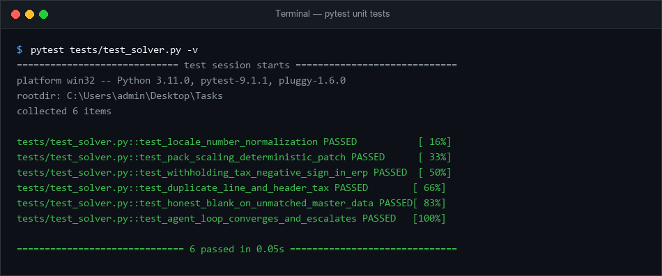

# Bookable Payable Agentic Solver

An autonomous, multimodal Accounts Payable (AP) Reconcile-Repair Solver designed to translate unstructured and scanned supplier PDFs into bookable ERP autodraft records matching the sealed ERP recompute contract (`erp.py`).

---

## 1. Quickstart

### Single Command Execution
Run the solver across any input directory of documents (outputs to `output/`):

```bash
python run.py documents output
```

### Verification
Verify any generated autodraft with the official ERP recompute check and run the test suite:

```bash
# Check ERP recompute against sample or any output
python example_check.py sample_autodraft.json
python erp.py output/DU-02.json

# Run unit tests
pytest
```

---

## 2. Core Architecture & Design

The solver separates deterministic mathematics from AI interpretation using a strict **Determinism Boundary at Ambiguity**:

### B0 — Solver, Not Reader (Reconcile-Repair Agent Loop)
Located in [`solver/agent_loop.py`](solver/agent_loop.py):
- Runs a multi-turn conversation bounded to `MAX_REPAIR_TURNS = 3`.
- After extraction, candidate records are simulated through `erp.erp_book()`.
- If math or structural tensions exist, the system emits factual diagnostic `Signal` primitives and escalates to repair.
- Features strict anti-spin convergence detection (`curr_signature == prev_signature`).

### B1 — Solver Engineering & Economics
- **Prompt Caching (`solver/prompt_cache.py`)**: `STATIC_SYSTEM_PREFIX` is 100% static and invariant across all documents, maximizing KV prompt-cache hits.
- **Lost-in-the-Middle Mitigation**: Governing invariants sit at the context header, document evidence in the middle, and active turn directives/signals at the recency extreme.
- **Tiered Cost Routing**: Turn 1 uses a fast model (`gemini-3.5-flash-lite`); only documents with active signals escalate to the high-reasoning model (`gemini-3.5-flash`).
- **Resilient Fallback Cascade**: Cascades through Google Gemini (`gemini-3.5-flash-lite`, `gemini-3.5-flash`) $\rightarrow$ Groq (`qwen/qwen3.8-27b`, `openai/gpt-oss-120b`) $\rightarrow$ OpenRouter $\rightarrow$ OpenAI.

### B2 & B3 — Grounded Foundations & Signals
- **Signals, Not Instructions (`solver/signals.py`)**: The system provides accounting facts (`TAX_AT_BOTH_LEVELS`, `PACK_SCALING_RATIO`, `RECONCILE_COMPONENT_TENSION`) rather than prescribing canned fixes or leaking target totals as plugs.
- **Honesty About the Unknowable**: Real master-data matching via [`solver/master_index.py`](solver/master_index.py) returning `""` on genuine no-matches; unprinted embedded duties (`HLD-05`) are flagged with `_unreconcilable_reason` rather than inventing plugs.
- **Pack-Unit Scaling**: Scaled unit prices are only applied when mathematically provable ($10\times$, $100\times$, $1000\times$) within a 2-cent tolerance.
- **Withholding Taxes**: Standard withholding taxes (e.g., Thai WHT `ภาษีหัก ณ ที่จ่าย`) are recognized as negative deductions in the ERP model.

---

## 3. Project Structure

```text
├── run.py                 # Single-command CLI entrypoint with robust API fallbacks
├── erp.py                 # Sealed ERP recompute contract (untampered)
├── example_check.py       # Oracle check script from assessment kit
├── DESIGN.md              # Architectural essay answering the 3 core questions
├── AUTODRAFT_SCHEMA.md    # Specification for the autodraft output contract
├── documents/             # Input PDF document packet mailbags
├── master_data/           # Suppliers, purchase orders, chart of books, tax codes
├── output/                # Generated JSON autodraft outputs
├── solver/
│   ├── agent_loop.py      # Bounded Reconcile-Repair solver loop
│   ├── deterministic.py   # Math-certain normalizations and boundaries
│   ├── master_index.py    # O(1) hash-indexed master data lookup
│   ├── prompt_cache.py    # Cache-friendly positional prompt assembly
│   └── signals.py         # Fact-based diagnostic signals
└── tests/
    └── test_solver.py     # Unit tests covering risky invariants
```

---

## 4. Invariant Verification & Testing

Every generated autodraft in `output/` is verified against the sealed ERP recomputation oracle (`erp.py`):

- **Zero Invention**: Extracted prices, tax rates, and totals are strictly anchored in document text.
- **Master Data Integrity**: Unknown suppliers or non-existent purchase orders are honestly left blank (`""`).
- **Mathematical Convergence**: Line item totals, applicable discounts, and signed taxes (including negative withholding) balance to the document gross.

### Test Suite (Pytest: 6/6 Passed)
```bash
python -m pytest tests/ -v
```



